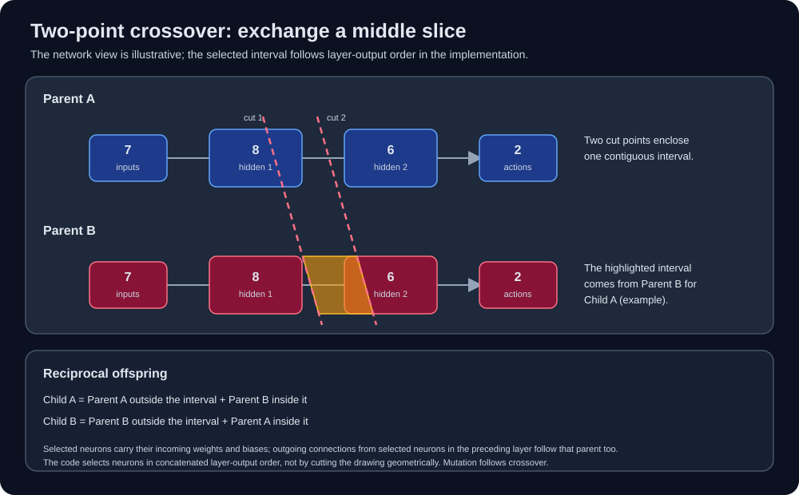

# Selection, crossover, and mutation

After ranking, the GA seeds a survivor pool with three copies of the top 10%
of the population (at least one elite). It also considers the current
individuals for probabilistic retention: fitter individuals have a higher
chance, using fitness scaled between the weakest and strongest individual in
the generation. When every fitness value is equal, the retention probability
is 0.1. The population is then filled or trimmed to its configured size.

The first 40% of the resulting population (at least two individuals, rounded
to an even number) forms the mating pool. Its members are paired in shuffled
order. Each pair produces two reciprocal offspring with
`two_point_crossover`: two cut points define a contiguous interval in the
ordered list of layer-output neurons. Within that interval, a child inherits
each selected neuron's incoming weights and bias from one parent; outside it,
those values come from the other. Connections leaving selected neurons in
the preceding layer are inherited from the same parent. The second offspring
reverses the parent roles. This is a neuron-level crossover, not a raw slice
through the flattened weight tensors.

The clip highlights the half-open interval `[3, 12)` in the ordered list of
layer-output neurons, separates copied segments, transports the donor segments
into new children while leaving the parents intact, and then colors the children's
biases and weights by their source parent (cyan for A, green for B). Input
observations are not inherited parameters. For illustration, both children
use the same cut points; the GA samples cut points independently for each
actual crossover call. The parameter colors are checked against children
produced by the real crossover function. Mutation occurs afterward and is
not shown.

The offspring are reset and mutated. Each network parameter independently
has a 0.1 probability of receiving Gaussian noise scaled by 0.2. Offspring
replace the tail of the selected pool, and the GA restores the configured
population size. These rates are implementation constants in
`src/ga/ga_core.py` and `src/ga/network.py`, not training CLI options.
