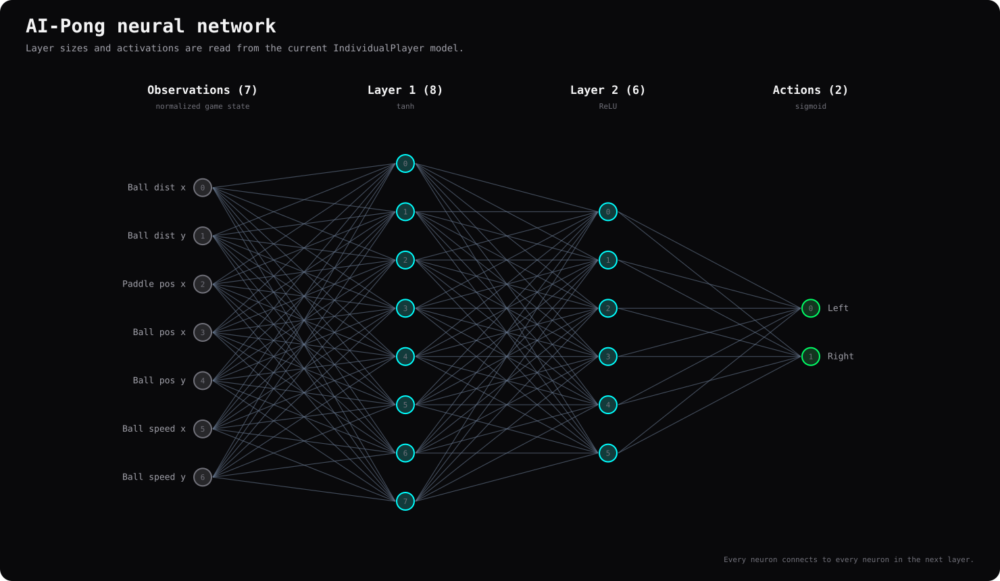

# Neural network

Each `IndividualPlayer` uses a fully connected **7 → 8 → 6 → 2** network:
seven input values, hidden layers of eight and six neurons, and two action
outputs. The inputs are normalized ball-to-paddle distances, paddle and ball
positions, and the ball's normalized horizontal and vertical velocity. The
hidden layers use `tanh` and ReLU; the output layer uses sigmoid. Outputs
above 0.5 activate the corresponding **Left** or **Right** action.

The clip carries seven illustrative normalized inputs into the network, focuses
on an actual neuron's weighted contributions, bias, sum and activation, and then
propagates signals through the actual PyTorch model. Positive values are blue,
negative values are pink/coral, and zero is neutral; cyan/green remain portfolio
accents and crossover donor colors, not activation signs. It displays the computed
activations and applies the sigmoid output threshold to obtain a paddle
action. This is a freshly initialized network with seed `334`, **not a trained
elite or a gameplay performance demonstration**. Both active outputs, or
neither active output, result in no movement.

The model is implemented with PyTorch's `nn.Linear` layers.
`BatchedPopulationBrain` stacks the individuals' weights and
biases, then evaluates them together using batched matrix multiplication.
This lets one forward pass evaluate all players at each simulation step.
PyTorch uses CUDA when available and otherwise runs on the CPU.

`NumPy` is used for arrays, helpers such as
the fitness function's squashing operation while `PyTorch` stores and
evaluates the neural-net params.

## Modular gameplay explanations

The three additional Manim scenes are driven by one validated gameplay-trace
JSON file and one explicitly selected decision index:

| Scene               | Recorded information explained                                                                                               |
|---------------------|--------------------------------------------------------------------------------------------------------------------------------|
| `observations`      | The y-down court state and the seven observation formulas, with the actual input vector.                                     |
| `network-actions`   | That same input, checkpoint activations and signed weights, and the actual two sigmoid decisions.                            |
| `actions-execution` | The matching action, measured paddle displacement, legal center bounds, CPU movement, and subsequent recorded states/events. |

These are independent modules rather than clips spliced from separate episodes.
The trace records checkpoint SHA-256, capture configuration and software
versions, parameter matrices/biases once, and pre-step/observation/activation/
action/post-step data per decision. Missing run, generation, and validation
provenance is explicitly marked `unknown`. The capture command requires a
specific checkpoint; it never selects the latest file from `runs/` and does
not change training or physics. See
[regenerating the diagrams and animations](animation-pipeline.md) for the
exact commands, and [capturing gameplay traces](animation-pipeline.md#capturing-a-gameplay-trace)
for provenance and quality details.
